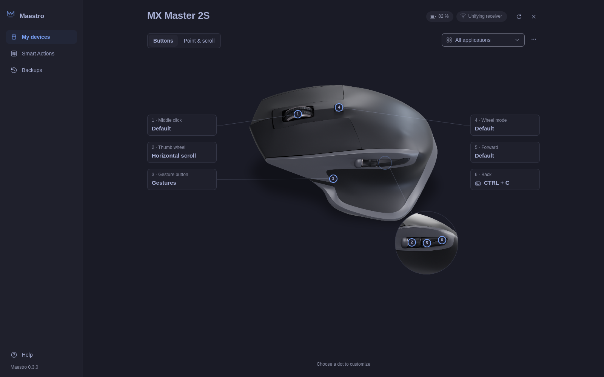

# Maestro

Maestro is an Omarchy bar widget and settings app for Logitech MX mice: battery,
pointer speed, SmartShift, scrolling, button remapping, gestures and per-app
profiles.



Maestro talks to the mouse directly over HID++ using only the Python standard
library. It needs no Logitech software and no Solaar daemon, and nothing in it
runs as root.

## What it does

- **Bar widget.** Shows battery level and charging state. Click it for DPI
  presets, ratchet or free-spin wheel mode, the SmartShift threshold and
  natural scrolling.
- **Settings app.** Assign mouse buttons to shortcuts, Omarchy and Hyprland
  actions, typed text or commands. Map the gesture button to window, workspace,
  media or zoom gestures. Set thumb-wheel behavior and give each application its
  own profile.
- **Smart Actions.** Build short routines from shortcuts, typed text, delays,
  commands and clicks, then assign them to a button.
- **Background service (optional).** `maestrod` keeps your buttons, gestures and
  saved settings active, and puts them back after the mouse sleeps or
  reconnects.
- **Command line.** `maestro status`, `dpi`, `smartshift`, `scroll` and
  `diagnose` for scripts and device reports.

Settings apply as you change them, with **Undo** for the last change and
automatic config backups you can restore from the app.

More screenshots: [home](docs/screenshots/home.png),
[gestures](docs/screenshots/gesture-panel.png),
[Smart Actions](docs/screenshots/smart-actions.png) and the
[light theme](docs/screenshots/device-light.png).

## Supported mice

| Model | Status |
|---|---|
| MX Master 2S | Tested on a Unifying receiver |
| MX Master, MX Master 3, 3S, 4 | Expected to work, not yet tested |
| MX Anywhere 2, 2S, 3, 3S | Expected to work, not yet tested |
| MX Vertical, MX Ergo, MX Ergo S | Expected to work, not yet tested |

Only the MX Master 2S has been tested on real hardware, and on it the
gesture button has not yet been confirmed end to end. Other models are
supported from the HID++ specification, and Maestro discovers each mouse's
features at runtime instead of assuming them. Bluetooth and Bolt connections
are expected to work but are also untested. If you own another MX mouse,
please run `maestro diagnose` and share the output in a
[device report](https://github.com/nodrej/omarchy-maestro/issues/new?template=device_report.yml).
See [supported devices](docs/supported-devices.md) for details.

Maestro only talks to devices it identifies as MX mice. Keyboards and gaming
mice on the same receiver are never configured.

## Requirements

- [Omarchy](https://omarchy.org) with its Quickshell-based shell (it provides
  Quickshell and Qt Quick Controls)
- `python3` 3.10 or newer (standard library only, nothing to install)
- Read and write access to the mouse's `/dev/hidraw*` node. Many systems already
  grant it; otherwise install the udev rule described in
  [device access](#device-access).
- Optional: `notify-send` (from libnotify, included in Omarchy) for the notice
  shown when the app was updated while open
- Optional, for the background service: access to `/dev/uinput`

Stop Solaar and logiops daemons while using Maestro. Only one program should
own the mouse's HID++ connection at a time.

## Install

### From the Omarchy plugin marketplace

```bash
omarchy plugin install https://github.com/nodrej/omarchy-maestro --enable
```

Omarchy clones the plugin into
`~/.config/omarchy/plugins/io.github.nodrej.maestro`, validates it and adds the
widget to your bar. Keep that folder in place: the widget, the settings app and
the command line all run from it.

### Manually

```bash
git clone https://github.com/nodrej/omarchy-maestro \
  ~/.config/omarchy/plugins/io.github.nodrej.maestro
omarchy-shell shell rescanPlugins
omarchy plugin enable io.github.nodrej.maestro
```

Rescanning is asynchronous. If enabling fails, wait until
`omarchy-shell shell listPlugins` lists Maestro and try again. For development
you can clone elsewhere and link the clone into the plugins folder instead.

### Check that it works

```bash
cd ~/.config/omarchy/plugins/io.github.nodrej.maestro
bin/maestro status
```

If the mouse is listed, the widget can read it. If you see a permission error,
set up [device access](#device-access).

### Optional: launcher, command line and window rule

These steps add Maestro to the application launcher, put `maestro` on your
PATH and open the settings app as a centered floating window. They never
overwrite existing files.

```bash
cd ~/.config/omarchy/plugins/io.github.nodrej.maestro
mkdir -p ~/.local/bin ~/.local/share/applications ~/.local/share/icons/hicolor/scalable/apps
ln -s "$PWD/bin/maestro" ~/.local/bin/maestro
ln -s "$PWD/bin/maestro-settings" ~/.local/bin/maestro-settings
ln -s "$PWD/packaging/desktop/io.github.nodrej.maestro.desktop" ~/.local/share/applications/
ln -s "$PWD/packaging/desktop/io.github.nodrej.maestro.svg" ~/.local/share/icons/hicolor/scalable/apps/
bash packaging/install.sh --window-rule-only
```

The window rule adds `~/.config/hypr/maestro.lua` and one marked line in
`hyprland.lua`. It saves a timestamped copy of `hyprland.lua` first, and running
it again is safe.

Command line tools for other desktops (pipx, a virtual environment or an Arch
package) are covered in [docs/install.md](docs/install.md).

## Start Maestro's background service

The bar widget and the settings app work without the service. Button
remapping, gestures, Smart Actions and per-app profiles need `maestrod` running.
Without it the app still saves your changes and shows a banner until the
service starts.

### Device access

The service needs two kinds of access. This is a one-time step that needs
`sudo`; review the files first, they are short.

- `packaging/udev/70-maestro.rules` lets the user at the active local seat
  read and write Logitech hidraw nodes (to talk to the mouse) and
  `/dev/uinput` (to create a virtual keyboard and mouse for your actions).
- `packaging/modules-load/maestro-uinput.conf` loads the `uinput` kernel module
  at boot.

```bash
cd ~/.config/omarchy/plugins/io.github.nodrej.maestro
sudo install -D -m 0644 packaging/udev/70-maestro.rules /etc/udev/rules.d/70-maestro.rules
sudo install -D -m 0644 packaging/modules-load/maestro-uinput.conf /etc/modules-load.d/maestro-uinput.conf
sudo modprobe uinput
sudo udevadm control --reload-rules && sudo udevadm trigger
```

**Security note.** Access to `/dev/uinput` means any program running as you can
create virtual input devices and type or click in your session. Steam Input and
input-remapper make the same trade-off. The rule uses `uaccess`, so access is
limited to the user at the active local seat and nothing becomes
world-writable. If you only want the bar widget, skip the uinput part.

### Run it

Try it in a terminal first:

```bash
cd ~/.config/omarchy/plugins/io.github.nodrej.maestro
bin/maestrod --check-config
bin/maestrod
```

Stop it with Ctrl+C; it releases every remapped control. To start it with your
desktop session, install the systemd user unit. It runs as your user, never
root, and starts `~/.local/bin/maestrod`. Skip the `ln -s` line if you already
installed `maestrod` there with pipx or `packaging/install.sh`:

```bash
cd ~/.config/omarchy/plugins/io.github.nodrej.maestro
mkdir -p ~/.local/bin ~/.config/systemd/user
ln -s "$PWD/bin/maestrod" ~/.local/bin/maestrod
cp packaging/systemd/maestrod.service ~/.config/systemd/user/
systemctl --user daemon-reload
systemctl --user enable --now maestrod.service
```

Check it with `systemctl --user status maestrod` and read its log with
`journalctl --user -u maestrod`. See
[daemon configuration](docs/configuration.md) for details.

## Usage

**Bar widget.** The pill shows a mouse icon and the battery percent, a charging
mark while charging, and the theme's warning color at 15% or less. A dimmed icon
means the mouse is asleep or not found. Click the pill to open the panel with
DPI presets, wheel mode, the SmartShift threshold (applied when you release the
slider) and natural scrolling. Features the mouse does not support are hidden.
**Open Maestro** at the top right of the panel opens the settings app.

**Settings app.** Open it from the bar panel, from the launcher (after the
optional launcher step), or with `bin/maestro-settings`. Choose a mouse on the
home screen, then:

- **Buttons**: choose a numbered dot or label on the device image to pick an
  action. Search the catalog, record a keyboard shortcut, choose a Smart Action
  or enter a command. Commands run directly, without a shell. **Try it** runs
  the action once.
- **Gestures**: pick a bundle (window navigation, workspaces, media, zoom or
  custom), then change any direction.
- **Point & scroll**: DPI, natural scrolling, SmartShift and thumb-wheel mode
  and speed.
- **Profiles**: use the **All applications** dropdown for shared settings, or
  **Add application** for a per-app profile.
- **Smart Actions**: start from a template or build your own routine, then
  **Assign to a button**.
- **Backups**: restore an earlier config. **Reset to defaults** keeps your Smart
  Actions.

Every change saves immediately and can be undone with **Undo**. **Help** has a
short tour, keyboard shortcuts and image credits.

**Command line.**

```bash
bin/maestro status                       # connected MX mice and their settings
bin/maestro status --json
bin/maestro dpi 1200                     # must be a value the mouse supports
bin/maestro smartshift --mode freespin   # or ratchet
bin/maestro smartshift --threshold 20    # 1-254, 255 = never switch
bin/maestro scroll --invert on           # natural scrolling on or off
bin/maestro diagnose                     # identifier-free device report
```

Use `--mouse N` or `--device "MX Master 3S"` to pick one of several mice.

## Configure

**Bar widget.** Use the shell's bar widget settings, or edit the Maestro entry in
`~/.config/omarchy/shell.json`. Save a copy of that file before editing it.

```json
{
  "id": "io.github.nodrej.maestro",
  "dpiPresets": "800, 1000, 1600, 2400",
  "showPercent": true
}
```

`dpiPresets` is a comma-separated list; values the mouse does not support are
dropped. `showPercent: false` hides the percent in the pill but keeps it in the
panel. Changes apply automatically.

**Buttons, gestures and profiles.** The settings app writes
`~/.config/maestro/config.json` and keeps backups next to it. You can also edit
the file by hand; the service validates it and keeps the last good version if
an edit is invalid. See [daemon configuration](docs/configuration.md) and
[automations](docs/automations.md), with examples in
[examples/config](examples/config).

## Remove

Run only the steps for the parts you installed. First, if you want the mouse
back at its old DPI, SmartShift or scroll direction, set them now; removing
Maestro does not reset the mouse.

```bash
# Background service
systemctl --user disable --now maestrod.service
rm -f ~/.config/systemd/user/maestrod.service ~/.local/bin/maestrod
systemctl --user daemon-reload

# Window rule (restores any earlier maestro.lua and removes the marked line)
bash ~/.config/omarchy/plugins/io.github.nodrej.maestro/packaging/uninstall.sh --window-rule-only

# Launcher, command line and icon links
rm -f ~/.local/bin/maestro ~/.local/bin/maestro-settings \
  ~/.local/share/applications/io.github.nodrej.maestro.desktop \
  ~/.local/share/icons/hicolor/scalable/apps/io.github.nodrej.maestro.svg

# Command line tools installed with pipx (after packaging/install.sh, run
# packaging/uninstall.sh instead; see docs/install.md)
pipx uninstall maestro-mouse

# The plugin itself (disables the widget and deletes the plugin folder)
omarchy plugin remove io.github.nodrej.maestro

# Device access rules
sudo rm -f /etc/udev/rules.d/70-maestro.rules /etc/modules-load.d/maestro-uinput.conf
sudo udevadm control --reload-rules && sudo udevadm trigger
```

Your Maestro settings and backups stay in `~/.config/maestro`, and app state
in `~/.local/state/maestro`. Delete those folders too if you do not plan to
reinstall. If you edited `shell.json` by hand, restore your saved copy and run
`omarchy restart shell`.

## Troubleshooting

See [troubleshooting](docs/troubleshooting.md) for missing devices, permission
errors, Solaar or logiops conflicts, Bolt pairing and Bluetooth.

## Roadmap

- Confirm support for more MX models and connections with testers
- Confirm gesture-button operation on real hardware
- Improved accessibility, including a screen reader review
- Packages for more distributions

## Contributing

Bug reports, device reports and pull requests are welcome. See
[CONTRIBUTING.md](CONTRIBUTING.md) for tests, UI previews and hardware testing
rules, and [CHANGELOG.md](CHANGELOG.md) for release notes.

## Credits

The MX Master 2S device image is rendered from
[Logitech MX master 2S (@danish_blends)](https://sketchfab.com/3d-models/logitech-mx-master-2s-danish-blends-e8f3235951934a01aba4e0ee3de72e71)
by **danish_blends**, licensed under
[CC BY-NC 4.0](https://creativecommons.org/licenses/by-nc/4.0/). Changes: new
lighting and camera, status light hidden, contact shadow added. The neutral
silhouette shown for other models is traced from the same render. These images
are not covered by Maestro's MIT license and may not be used commercially. See
[app/assets/devices/mx-master/LICENSE.txt](app/assets/devices/mx-master/LICENSE.txt).
The Maestro mark and interface icons are original project assets.

Not affiliated with or endorsed by Logitech. Logitech, MX Master and related
marks belong to their owners.

## License

Code and original interface assets: [MIT](LICENSE). The device images in
`app/assets/devices` use the separate CC BY-NC 4.0 license described in Credits.
